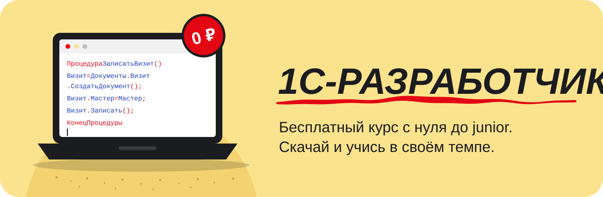

<p align="center">
  
</p>

# 1С-разработчик

**Бесплатный курс по разработке на платформе 1С:Предприятие с нуля до уровня junior.**

«1С-разработчик» - интерактивный учебник, который устанавливается на компьютер и открывается в браузере. Курс полностью бесплатный: оплата, подписка и регистрация не требуются. Проходить его можно в удобном темпе, прогресс сохраняется автоматически.

Курс находится в разработке. Программа составлена полностью, уроки публикуются по одному и становятся доступны после обновления.

## О курсе

Каждый урок состоит из нескольких коротких шагов. Следующий шаг открывается вопросом, который мог бы задать студент, поэтому материал подаётся постепенно.

Все примеры построены на одной учебной конфигурации для барбершопа с клиентами, мастерами, услугами, материалами и денежными расчётами. По ходу курса она дополняется справочниками, документами и отчётами, а к финалу становится проектом для портфолио.

Новые термины объясняются через бытовые аналогии. Для тех, кто знаком с Python, в уроках приводятся параллели между двумя языками. Каждый урок завершается итогами, вопросами для самопроверки и словарём терминов.

## Установка

Потребуются [Git](https://git-scm.com/downloads), [Node.js](https://nodejs.org/) 20.9 или новее и [pnpm](https://pnpm.io/installation).

```bash
git clone https://github.com/vleypi/1C-course.git
cd 1C-course
pnpm --dir frontend install
pnpm --dir frontend dev
```

После запуска учебник доступен по адресу [http://localhost:3000](http://localhost:3000).

## Обновление

Новые уроки загружаются из репозитория.

```bash
git pull
pnpm --dir frontend install
pnpm --dir frontend dev
```

Прогресс хранится в браузере и при обновлении курса сохраняется.

## Программа курса

Программа включает вводный модуль, 13 основных модулей и два итоговых проекта, всего 95 тем и 359 уроков. Модуль рассчитан на две недели, итоговый проект на четыре.

| № | Модуль | Результат |
|---|---|---|
| 00 | Вводная часть и знакомство | Понимание, что такое 1С и чем занят 1С-разработчик, подготовленное рабочее место |
| 01 | Введение в 1С:Предприятие | Каркас конфигурации «Барбершоп», собранный без программирования |
| 02 | Управляемые формы и основы программирования | Программирование на языке 1С и работа с формами |
| 03 | Запросы в 1С и СКД | Получение данных из базы и построение отчётов |
| 04 | Оперативный учёт: часть 1 | Остатки, партии, себестоимость, деньги |
| 05 | Оперативный учёт: часть 2 | Отчёты, дизайн, планировщик, дашборд, роли |
| 06 | Регламентированный учёт | Основы бухучёта и его реализация в 1С |
| 07 | Расчёт заработной платы. Мобильная разработка | Расчёт зарплаты и первое мобильное приложение |
| 08 | Интеграции и веб-сервисы | Обмен данными через файлы, API и веб-сервисы |
| 09 | Основы администрирования и бизнес-процессы | Бизнес-процессы и администрирование серверной 1С |
| - | Итоговый проект | Проект для портфолио на основе изученного |
| 10 | Основы работы с БСП | Работа с Библиотекой стандартных подсистем |
| 11 | Основы работы с типовыми конфигурациями | Доработка типовых конфигураций без изменения их кода |
| 12 | Доработка печатных форм и обновление типовых конфигураций | Печатные формы и обновление типовых конфигураций |
| 13 | Полезные инструменты. Алгоритмы для собеседований | Обмены данными и подготовка к собеседованиям |
| - | Итоговый проект с БСП | Усложнённый проект для портфолио с использованием БСП |

### Уроки по темам

<details open>
<summary><b>Модуль 00. Вводная часть и знакомство</b> · готово 2 из 18</summary>

**Тема 1. Знакомство с 1С**

1. ✅ Что такое 1С:Предприятие
2. ✅ Платформа, конфигурация, информационная база
3. ⏳ Типовые конфигурации: Бухгалтерия, ЗУП, УТ, ERP
4. 🔒 Кто такой 1С-разработчик и чем он занят
5. 🔒 Рынок, грейды и сертификация 1С
6. 🔒 Файловый и клиент-серверный режим на пальцах
7. 🔒 Два режима запуска: Конфигуратор и 1С:Предприятие
8. 🔒 Обзор языка 1С: как выглядит код
9. 🔒 1С и Python: что похоже, а что нет
10. 🔒 Подготовка к практике
11. 🔒 Практика по теме: раскладываем барбершоп на объекты 1С (на бумаге)

**Тема 2. Как устроено обучение и рабочее окружение**

1. 🔒 Как учиться по этому курсу
2. 🔒 Учебная версия платформы: что это и где взять
3. 🔒 Установка платформы (Windows / macOS: варианты)
4. 🔒 Создаём первую информационную базу
5. 🔒 Первый запуск Конфигуратора: экскурсия по окну
6. 🔒 «Привет, мир» на языке 1С
7. 🔒 Практика по теме

</details>

<details>
<summary><b>Модуль 01. Введение в 1С:Предприятие</b> · готово 0 из 38</summary>

**Тема 1. Основы конфигурирования. Справочники**

1. 🔒 Дерево конфигурации: из чего она состоит
2. 🔒 Подсистемы: разделы программы
3. 🔒 Что такое справочник
4. 🔒 Создаём справочник «Клиенты»
5. 🔒 Реквизиты и их типы
6. 🔒 Иерархические справочники: группы и элементы
7. 🔒 Табличные части справочника
8. 🔒 Подчинённые справочники и владельцы
9. 🔒 Предопределённые элементы
10. 🔒 Подготовка к практике
11. 🔒 Практика по теме: справочники барбершопа

**Тема 2. Конфигурирование документов**

1. 🔒 Что такое документ и чем он отличается от справочника
2. 🔒 Номер и дата документа
3. 🔒 Реквизиты шапки
4. 🔒 Табличная часть документа
5. 🔒 Документ «Приходная накладная»
6. 🔒 Документ «Оказание услуги»
7. 🔒 Проведение документа: что это значит
8. 🔒 Практика по теме

**Тема 3. Регистры и движения документов**

1. 🔒 Зачем нужны регистры
2. 🔒 Регистр сведений
3. 🔒 Регистр накопления: остатки и обороты
4. 🔒 Измерения, ресурсы, реквизиты
5. 🔒 Движения документа
6. 🔒 Конструктор движений документов
7. 🔒 Проверяем движения в режиме 1С:Предприятие
8. 🔒 Практика по теме

**Тема 4. Дополнительные настройки конфигурации. Печатные формы**

1. 🔒 Константы
2. 🔒 Перечисления
3. 🔒 Командный интерфейс и рабочий стол
4. 🔒 Что такое печатная форма и макет
5. 🔒 Конструктор печатных форм
6. 🔒 Печатная форма документа «Оказание услуги»
7. 🔒 Практика по теме

**Тема 5. Проект модуля: груминг-салон**

1. 🔒 Постановка задачи
2. 🔒 Справочники и документы салона
3. 🔒 Регистры и движения
4. 🔒 Печатная форма и сдача проекта

</details>

<details>
<summary><b>Модуль 02. Управляемые формы и основы программирования</b> · готово 0 из 39</summary>

**Тема 1. Формы и подсистемы**

1. 🔒 Что такое управляемая форма
2. 🔒 Клиент и сервер: где выполняется код
3. 🔒 Элементы формы и реквизиты формы
4. 🔒 Форма элемента, форма списка, форма выбора
5. 🔒 Команды формы
6. 🔒 События формы
7. 🔒 Директивы компиляции: &НаКлиенте, &НаСервере
8. 🔒 Практика по теме

**Тема 2. Переменные и типы данных**

1. 🔒 Переменные в 1С
2. 🔒 Примитивные типы: Число, Строка, Дата, Булево
3. 🔒 Неопределено и Null
4. 🔒 Преобразование типов
5. 🔒 Работа со строками
6. 🔒 Работа с датами
7. 🔒 Ссылочные типы
8. 🔒 Практика по теме

**Тема 3. Функции, процедуры, ветвления и циклы**

1. 🔒 Процедуры и функции
2. 🔒 Параметры: по ссылке и по значению (Знач)
3. 🔒 Возврат значения
4. 🔒 Если … Тогда … ИначеЕсли
5. 🔒 Тернарный оператор ?( )
6. 🔒 Цикл Для
7. 🔒 Цикл Для Каждого
8. 🔒 Цикл Пока
9. 🔒 Коллекции: Массив
10. 🔒 Коллекции: Структура и Соответствие
11. 🔒 Коллекции: ТаблицаЗначений
12. 🔒 Практика по теме

**Тема 4. Модули в 1С**

1. 🔒 Виды модулей
2. 🔒 Модуль объекта и модуль менеджера
3. 🔒 Модуль формы
4. 🔒 Общие модули и их флаги
5. 🔒 Обработка проведения кодом
6. 🔒 Оптимизация процедур проведения
7. 🔒 Практика по теме

**Тема 5. Проект модуля: программируем формы барбершопа**

1. 🔒 Постановка задачи
2. 🔒 Автоматика на формах документов
3. 🔒 Проведение кодом
4. 🔒 Сдача проекта

</details>

<details>
<summary><b>Модуль 03. Запросы в 1С и СКД</b> · готово 0 из 27</summary>

**Тема 1. Дополнительные сведения о функциях**

1. 🔒 Встроенные функции языка
2. 🔒 Работа с коллекциями через функции
3. 🔒 Обработка ошибок: Попытка … Исключение
4. 🔒 Практика по теме

**Тема 2. Запросы к базе данных**

1. 🔒 Как 1С хранит таблицы в базе
2. 🔒 Первый запрос: ВЫБРАТЬ … ИЗ
3. 🔒 Консоль запросов
4. 🔒 Условия: ГДЕ и параметры
5. 🔒 Сортировка и группировка
6. 🔒 Агрегатные функции
7. 🔒 Соединения таблиц
8. 🔒 Объединение запросов
9. 🔒 Функции языка запросов
10. 🔒 Виртуальные таблицы регистров
11. 🔒 Пакетные запросы и временные таблицы
12. 🔒 Практика по теме: автозаполнение цен

**Тема 3. Система компоновки данных**

1. 🔒 Что такое СКД
2. 🔒 Схема компоновки: набор данных
3. 🔒 Ресурсы и группировки
4. 🔒 Параметры и отборы
5. 🔒 Варианты отчёта и настройки пользователя
6. 🔒 Диаграммы в СКД
7. 🔒 Практика по теме: отчёт по выручке

**Тема 4. Проект модуля**

1. 🔒 Постановка задачи
2. 🔒 Документ «Перемещение товаров»
3. 🔒 Отчёт по движению товаров
4. 🔒 Сдача проекта

</details>

<details>
<summary><b>Модуль 04. Оперативный учёт: часть 1</b> · готово 0 из 37</summary>

**Тема 1. Отладка кода**

1. 🔒 Отладчик: точки останова
2. 🔒 Пошаговое выполнение и табло
3. 🔒 Замер производительности
4. 🔒 Практика по теме

**Тема 2. Оперативный и регламентированный учёт**

1. 🔒 Чем они отличаются
2. 🔒 Оперативное проведение
3. 🔒 Практика по теме

**Тема 3. Стратегии учёта товарных запасов**

1. 🔒 Учёт по средней
2. 🔒 FIFO и LIFO на пальцах
3. 🔒 Партионный учёт: регистр партий
4. 🔒 Практика по теме

**Тема 4. Учёт товаров по срокам годности**

1. 🔒 Постановка задачи
2. 🔒 Измерение «Срок годности» в регистре
3. 🔒 Списание по ближайшему сроку
4. 🔒 Практика по теме

**Тема 5. Учёт затрат по услугам и материалам**

1. 🔒 Что такое затраты
2. 🔒 Нормы расхода материалов на услугу
3. 🔒 Регистр затрат
4. 🔒 Практика по теме

**Тема 6. Контроль остатков при реализации. Списание по партиям**

1. 🔒 Зачем контролировать остатки
2. 🔒 Методики контроля: до записи и после записи
3. 🔒 Блокировки данных
4. 🔒 Списание по партиям кодом
5. 🔒 Практика по теме

**Тема 7. Расчёт выручки и прибыли**

1. 🔒 Выручка, себестоимость, прибыль на пальцах
2. 🔒 Регистр продаж
3. 🔒 Практика по теме

**Тема 8. Учёт денежных средств**

1. 🔒 Касса и расчётный счёт
2. 🔒 Документы поступления и расхода денег
3. 🔒 Регистр денежных средств
4. 🔒 Практика по теме

**Тема 9. Доработка цен номенклатуры**

1. 🔒 Периодический регистр сведений цен
2. 🔒 Срез последних
3. 🔒 Практика по теме

**Тема 10. Проект модуля**

1. 🔒 Постановка задачи
2. 🔒 Реализация
3. 🔒 Сдача проекта

</details>

<details>
<summary><b>Модуль 05. Оперативный учёт: часть 2</b> · готово 0 из 22</summary>

**Тема 1. Доработка и создание отчётов**

1. 🔒 Финансовые отчёты
2. 🔒 Внешние отчёты и обработки
3. 🔒 Практика по теме

**Тема 2. Доработка дизайна конфигурации**

1. 🔒 Стили конфигурации
2. 🔒 Картинки и оформление
3. 🔒 Практика по теме

**Тема 3. Контроль оказания услуг и оплаты. Связанные документы**

1. 🔒 Ввод на основании
2. 🔒 Структура подчинённости
3. 🔒 Контроль оплаты
4. 🔒 Практика по теме

**Тема 4. Монитор руководителя**

1. 🔒 Визуализация данных: диаграммы
2. 🔒 Дашборд с ключевыми показателями
3. 🔒 Практика по теме

**Тема 5. Планировщик загрузки сотрудников**

1. 🔒 Элемент «Планировщик»
2. 🔒 Запись клиентов на услуги
3. 🔒 Практика по теме

**Тема 6. Создание дополнительных ролей**

1. 🔒 Роли и права доступа
2. 🔒 Пользователи
3. 🔒 Практика по теме

**Тема 7. Проект модуля**

1. 🔒 Постановка задачи
2. 🔒 Реализация
3. 🔒 Сдача проекта

</details>

<details>
<summary><b>Модуль 06. Регламентированный учёт</b> · готово 0 из 25</summary>

**Тема 1. Краткое введение в бухгалтерский учёт**

1. 🔒 Зачем бизнесу бухгалтерия
2. 🔒 Активы и пассивы на пальцах
3. 🔒 Счета, дебет и кредит
4. 🔒 Практика по теме

**Тема 2. Планы счетов и двойная запись**

1. 🔒 План счетов в 1С
2. 🔒 Заводим собственные счета
3. 🔒 Субконто и планы видов характеристик
4. 🔒 Корреспонденция счетов и двойная запись
5. 🔒 Регистр бухгалтерии
6. 🔒 Практика по теме

**Тема 3. Программирование. Контроль остатков денежной массы**

1. 🔒 Безналичные деньги
2. 🔒 Контроль остатков денег кодом
3. 🔒 Практика по теме

**Тема 4. Движения денег по счетам бухучёта**

1. 🔒 Проводки по деньгам
2. 🔒 Контроль остатков на счетах
3. 🔒 Практика по теме

**Тема 5. Движения по прочим операциям**

1. 🔒 Операция (бухгалтерский и налоговый учёт)
2. 🔒 Практика по теме

**Тема 6. Бухгалтерские отчёты и командный интерфейс**

1. 🔒 Оборотно-сальдовая ведомость
2. 🔒 Карточка счёта
3. 🔒 Доработка командного интерфейса
4. 🔒 Практика по теме

**Тема 7. Проект модуля**

1. 🔒 Постановка задачи
2. 🔒 Реализация
3. 🔒 Сдача проекта

</details>

<details>
<summary><b>Модуль 07. Расчёт заработной платы. Мобильная разработка</b> · готово 0 из 28</summary>

**Тема 1. Графики работы и кадровая история**

1. 🔒 Графики работы
2. 🔒 Регистры кадровой истории
3. 🔒 Практика по теме

**Тема 2. Механизмы ПВР. Регистр расчёта**

1. 🔒 План видов расчёта
2. 🔒 Регистр расчёта
3. 🔒 Период действия и фактический период
4. 🔒 Вытеснение и зависимость по базе
5. 🔒 Оклад, больничный, премия
6. 🔒 Практика по теме

**Тема 3. Отчёт по зарплате и командный интерфейс**

1. 🔒 Отчёт по регистру расчёта
2. 🔒 Практика по теме

**Тема 4. Проведение зарплаты по затратам и бухгалтерии**

1. 🔒 Зарплата в затратах
2. 🔒 Зарплата в проводках
3. 🔒 Практика по теме

**Тема 5. Мобильная разработка: платформа, эмулятор, веб-сервер**

1. 🔒 Мобильная платформа 1С
2. 🔒 Установка эмулятора
3. 🔒 Веб-сервер и публикация
4. 🔒 Практика по теме

**Тема 6. Разработка и отладка мобильного приложения**

1. 🔒 Мобильная конфигурация
2. 🔒 Запись клиентов в салон
3. 🔒 Отладка на эмуляторе
4. 🔒 Практика по теме

**Тема 7. Сборка и установка на Android**

1. 🔒 Сборщик мобильных приложений
2. 🔒 Установка на телефон
3. 🔒 Практика по теме

**Тема 8. Проект модуля**

1. 🔒 Постановка задачи
2. 🔒 Реализация
3. 🔒 Сдача проекта

</details>

<details>
<summary><b>Модуль 08. Интеграции и веб-сервисы</b> · готово 0 из 36</summary>

**Тема 1. Текстовые файлы**

1. 🔒 Чтение и запись текстовых файлов
2. 🔒 Практика по теме

**Тема 2. Файлы Excel**

1. 🔒 Чтение Excel в 1С
2. 🔒 Загрузка цен из Excel
3. 🔒 Практика по теме

**Тема 3. DBF (Data Base File)**

1. 🔒 Формат DBF и работа с ним
2. 🔒 Практика по теме

**Тема 4. XML**

1. 🔒 XML на пальцах
2. 🔒 ЧтениеXML и ЗаписьXML
3. 🔒 Практика по теме

**Тема 5. JSON**

1. 🔒 JSON на пальцах
2. 🔒 ЧтениеJSON и ЗаписьJSON
3. 🔒 Практика по теме

**Тема 6. REST и SOAP**

1. 🔒 Что такое API
2. 🔒 REST на пальцах
3. 🔒 SOAP на пальцах
4. 🔒 Практика по теме

**Тема 7. API и Postman**

1. 🔒 Postman: первый запрос
2. 🔒 Практика по теме

**Тема 8. API в 1С: курс валют**

1. 🔒 HTTPСоединение и HTTPЗапрос
2. 🔒 Загрузка курса валют
3. 🔒 Практика по теме

**Тема 9. API в 1С: новости**

1. 🔒 Загрузка новостей
2. 🔒 Практика по теме

**Тема 10. XDTO и веб-сервис SOAP**

1. 🔒 XDTO-пакеты
2. 🔒 Веб-сервис для создания номенклатуры
3. 🔒 Практика по теме

**Тема 11. REST-сервисы (HTTP-сервисы)**

1. 🔒 HTTP-сервис в 1С
2. 🔒 Практика по теме

**Тема 12. Аутентификация в мобильном приложении**

1. 🔒 Регистрация и вход
2. 🔒 Практика по теме

**Тема 13. Записи клиентов из мобильного приложения**

1. 🔒 Передача документа «Запись клиента»
2. 🔒 Практика по теме

**Тема 14. Проект модуля**

1. 🔒 Постановка задачи
2. 🔒 Реализация
3. 🔒 Сдача проекта

</details>

<details>
<summary><b>Модуль 09. Основы администрирования и бизнес-процессы</b> · готово 0 из 27</summary>

**Тема 1. Бизнес-процессы в 1С**

1. 🔒 Что такое бизнес-процесс
2. 🔒 Карта маршрута
3. 🔒 Задачи и регистр адресации
4. 🔒 Практика по теме

**Тема 2. Бизнес-процесс закупки товаров**

1. 🔒 Постановка задачи
2. 🔒 Реализация
3. 🔒 Практика по теме

**Тема 3. Доработка процесса: проверка заполнения и точка условия**

1. 🔒 Точка условия
2. 🔒 Проверка заполнения
3. 🔒 Практика по теме

**Тема 4. Установка серверов MS SQL и 1С**

1. 🔒 Клиент-серверная архитектура
2. 🔒 Установка MS SQL / PostgreSQL
3. 🔒 Установка сервера 1С
4. 🔒 Практика по теме

**Тема 5. Создание серверной базы**

1. 🔒 Создание серверной базы
2. 🔒 Практика по теме

**Тема 6. Консоль администрирования серверов**

1. 🔒 Обзор консоли
2. 🔒 Сеансы, соединения, регламентные задания
3. 🔒 Практика по теме

**Тема 7. Работа с СУБД MS SQL**

1. 🔒 Резервное копирование и восстановление
2. 🔒 Практика по теме

**Тема 8. Хранилище конфигурации**

1. 🔒 Командная разработка
2. 🔒 Захват и помещение объектов
3. 🔒 Практика по теме

**Тема 9. Проект модуля**

1. 🔒 Постановка задачи
2. 🔒 Реализация
3. 🔒 Сдача проекта

</details>

<details>
<summary><b>Итоговый проект</b> · готово 0 из 11</summary>

**Тема 1. Конфигурация и мобильное приложение для автоматизации бизнеса**

1. 🔒 Техническое задание
2. 🔒 Оперативный учёт и себестоимость
3. 🔒 Деньги и финансовый результат
4. 🔒 Бухгалтерия
5. 🔒 Зарплата
6. 🔒 Аналитические отчёты
7. 🔒 Мобильное приложение
8. 🔒 Расширения конфигурации
9. 🔒 Оформление в портфолио

**Тема 2. Вопросы с собеседований**

1. 🔒 Частые вопросы junior 1С
2. 🔒 Разбор ответов

</details>

<details>
<summary><b>Модуль 10. Основы работы с БСП</b> · готово 0 из 12</summary>

**Тема 1. БСП: подсистема «Базовая функциональность»**

1. 🔒 Что такое БСП и зачем она
2. 🔒 ОбщегоНазначения и ОбщегоНазначенияКлиентСервер
3. 🔒 Практика по теме

**Тема 2. БСП: другие подсистемы**

1. 🔒 Обзор основных подсистем
2. 🔒 Практика по теме

**Тема 3. Введение во внедрение новых методов из БСП**

1. 🔒 1С:ИТС и документация БСП
2. 🔒 Практика по теме

**Тема 4. Внедрение БСП**

1. 🔒 Первоначальное внедрение
2. 🔒 Практика по теме

**Тема 5. Внешние отчёты и внешние печатные формы**

1. 🔒 Дополнительные отчёты и обработки
2. 🔒 Практика по теме

**Тема 6. Проект модуля**

1. 🔒 Внедрение БСП в «Барбершоп»

</details>

<details>
<summary><b>Модуль 11. Основы работы с типовыми конфигурациями</b> · готово 0 из 11</summary>

**Тема 1. Введение в типовые конфигурации**

1. 🔒 Обзор БП, УТ, ЗУП, ERP
2. 🔒 Практика по теме

**Тема 2. Устройство типовых решений и архитектура**

1. 🔒 Как устроены типовые
2. 🔒 Практика по теме

**Тема 3. Основные приёмы доработки объектов**

1. 🔒 Режимы поддержки
2. 🔒 Практика по теме

**Тема 4. Доработка без внесения изменений**

1. 🔒 Расширения конфигурации
2. 🔒 Дополнительные реквизиты и сведения
3. 🔒 Доработка движений документа через расширение
4. 🔒 Практика по теме

**Тема 5. Проект модуля**

1. 🔒 Доработка типовой через расширение

</details>

<details>
<summary><b>Модуль 12. Доработка печатных форм и обновление типовых конфигураций</b> · готово 0 из 9</summary>

**Тема 1. Доработка печатных форм в типовых**

1. 🔒 Печатные формы в типовых
2. 🔒 Внешние печатные формы
3. 🔒 Практика по теме

**Тема 2. Обновление типовых конфигураций**

1. 🔒 Как выходят обновления
2. 🔒 Обновление «на поддержке»
3. 🔒 Практика по теме

**Тема 3. Обновление модифицированной типовой**

1. 🔒 Сравнение и объединение
2. 🔒 Практика по теме

**Тема 4. Проект модуля**

1. 🔒 Внешние печатные формы для учебного проекта

</details>

<details>
<summary><b>Модуль 13. Полезные инструменты. Алгоритмы для собеседований</b> · готово 0 из 13</summary>

**Тема 1. Обмен данными между конфигурациями**

1. 🔒 Планы обмена
2. 🔒 Подписки на события
3. 🔒 Стандартные обработки обмена
4. 🔒 Практика по теме

**Тема 2. Алгоритмические собеседования**

1. 🔒 Сложность алгоритмов на пальцах
2. 🔒 Типовые задачи
3. 🔒 Практика по теме

**Тема 3. Тестирование типовых конфигураций**

1. 🔒 Подходы к тестированию
2. 🔒 Практика по теме

**Тема 4. Релизный цикл и стандарты разработки**

1. 🔒 Стандарты разработки 1С
2. 🔒 Релизный цикл

**Тема 5. Сертификация в 1С**

1. 🔒 1С:Профессионал и 1С:Специалист
2. 🔒 Как готовиться

</details>

<details>
<summary><b>Итоговый проект с БСП</b> · готово 0 из 6</summary>

**Тема 1. Конфигурация с БСП и мобильное приложение**

1. 🔒 Техническое задание
2. 🔒 Внедрение БСП
3. 🔒 Реализация учёта
4. 🔒 Мобильное приложение
5. 🔒 Оформление в портфолио

**Тема 2. Вопросы с собеседований**

1. 🔒 Разбор частых вопросов

</details>

## Какие задачи решает курс

Путь в 1С-разработку обычно лежит через платное обучение или самостоятельный поиск материалов в статьях, на форумах и в видео. Во втором случае сложно выстроить порядок изучения тем и понять, какие знания востребованы в работе.

Курс объединяет путь от знакомства с платформой до итогового проекта в единую программу. Каждый урок опирается только на пройденный материал. Если урок затрагивает тему из следующих разделов, он указывает, где она будет разобрана подробно.

## Автор

Курс разрабатывает [vleypi](https://github.com/vleypi). Об ошибках и неточностях можно сообщить в [Issues](https://github.com/vleypi/1C-course/issues).
